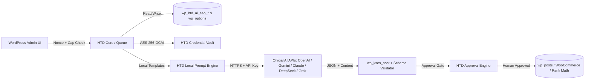

# DATA FLOW MAP

- **Removed Flows**: Zero connections to `softviet.vn` (license, prompt-bundle, update manifest/ZIP).
- **Safety Gate**: `WP_READ_ONLY_MODE=true`, `ALLOW_AUTOPUBLISH=false`, `REQUIRE_HUMAN_APPROVAL=true` prevent unapproved writes to WordPress LIVE.
